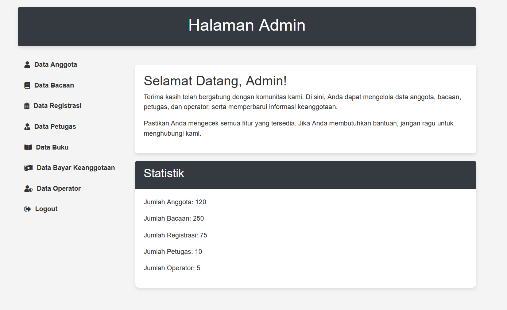
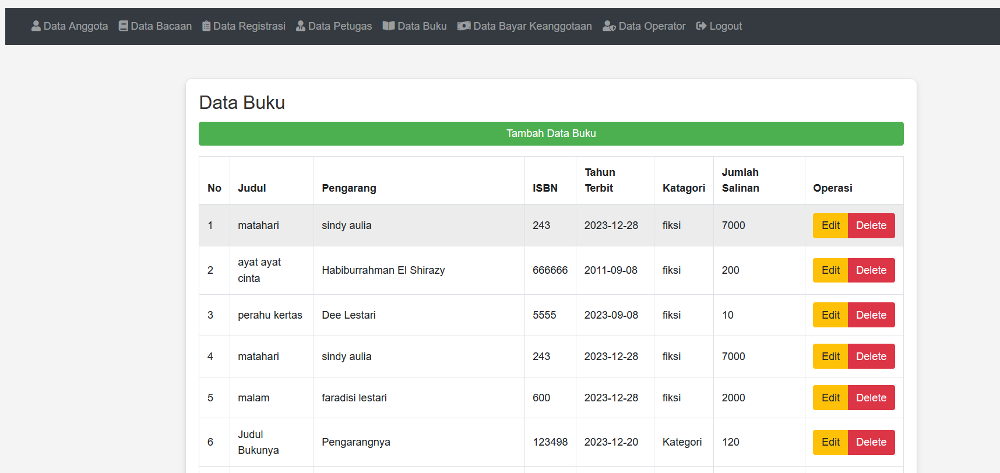
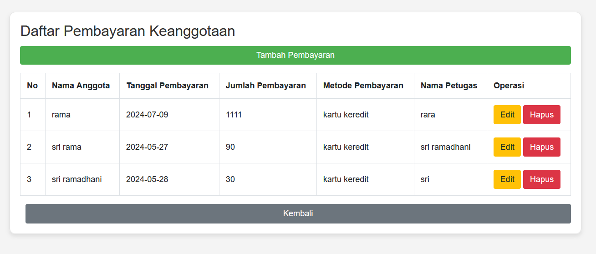
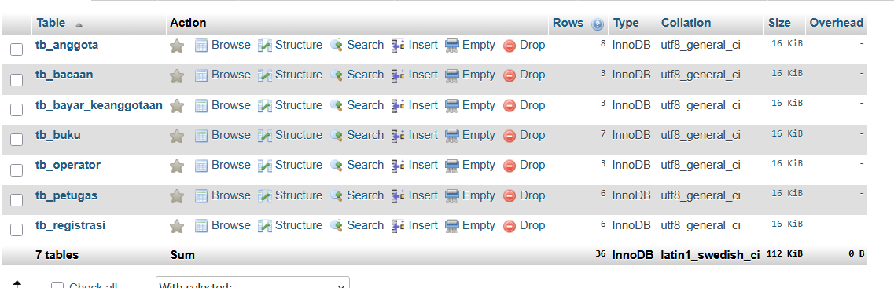

# Sistem Informasi Perpustakaan

## Deskripsi
Sistem informasi perpustakaan berbasis web untuk 
pengelolaan data anggota, buku, dan peminjaman.

## Tech Stack
- PHP Native
- MySQL
- HTML, CSS, JavaScript

## Fitur
- CRUD Data Anggota
- CRUD Data Buku
- CRUD Data Peminjaman
- Laporan peminjaman

  ## Tampilan Aplikasi

### 1. Dashboard Utama

### 2. Manajemen Data Buku & Anggota

### 3. Transaksi & Laporan Peminjaman

### 4. Database

## 🚀 Cara Menjalankan
1. Import file `database.sql` ke MySQL/phpMyAdmin
2. Letakkan folder project di `htdocs` XAMPP
3. Jalankan XAMPP (Apache + MySQL)
4. Akses: `http://localhost/nama-folder`
   
## 👤 Developer
**Sri Ramadhani**
S1 Informatika — Universitas Almuslim (2026)
IPK: 3,90 | Cumlaude | Wisudawan Terbaik 2026
📧 sriramadani596@gmail.com
